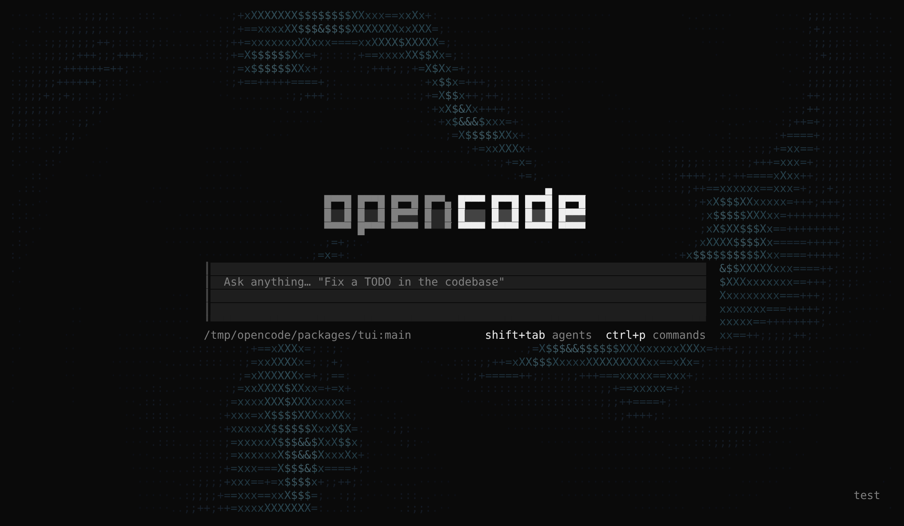
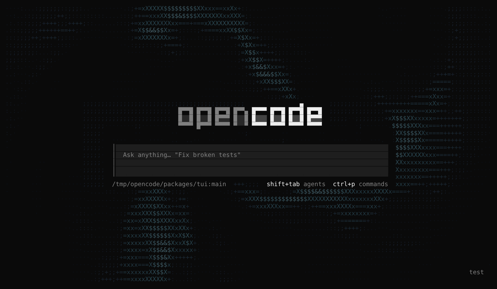
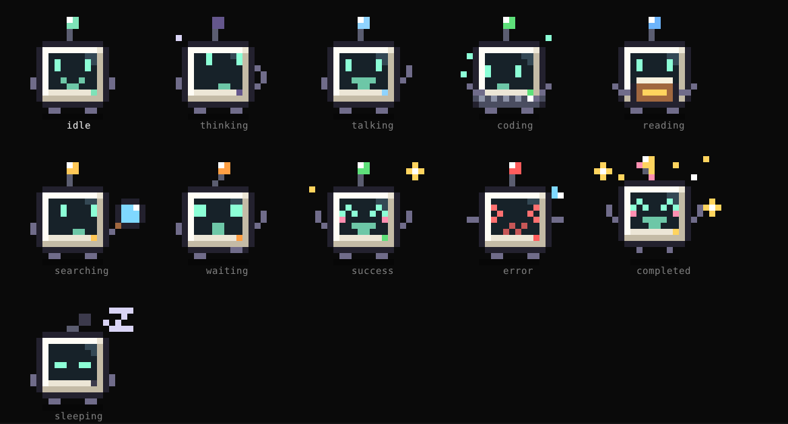
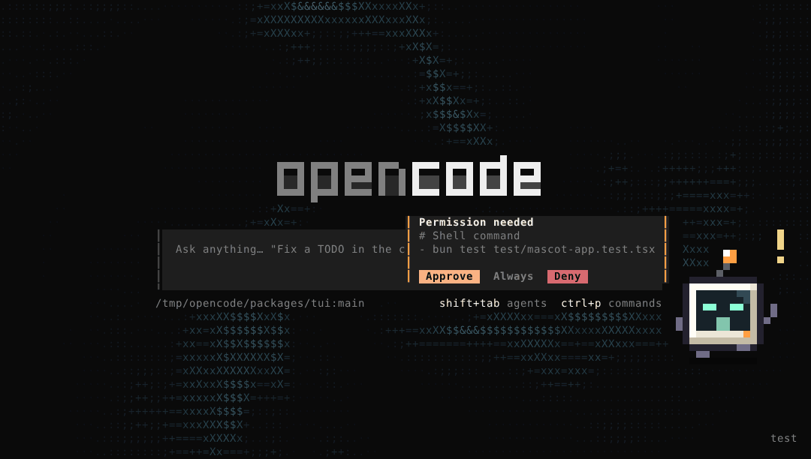

# swissmarley's OpenCode: Moods, Skins and Tilde

This fork restyles the OpenCode terminal UI along two independent axes, so any skin works with any mood, and adds a
companion that keeps you company while the agent works:

- **Moods** are animated backgrounds behind the interface: an interactive ASCII vortex, its watermark variant, a
  matrix rain, a rain pond, a starfield, a fire and an aurora. They react to your mouse, your keystrokes and the
  model's streaming output, and they never cover or shift any part of the interface.
- **Skins** change the look of the interface itself, in the spirit of 2000s media player skins: a color theme, the
  border rail beside messages and the prompt, the spinner, and a home screen tagline or logo.
- **Tilde, the mascot**, is a pixel-art companion floating over the interface. It acts out what the agent is doing in
  real time, says so in a speech bubble, and lets you approve or deny permission requests from any session.
- **Voice input** lets you dictate prompts: hold the microphone button beside the prompt and talk, or click it to start
  and stop. The transcript lands in the prompt for you to edit before you send it.

A skin never changes the mood: the background keeps running under every skin and only takes on the skin's colors.

> [!NOTE]
> This is a fork of [anomalyco/opencode](https://github.com/anomalyco/opencode). It is not built by the OpenCode team
> and is not affiliated with them. Everything else about OpenCode works as upstream documents it; see the
> [OpenCode docs](https://opencode.ai/v2/docs).



## What you get

### Moods

- **A slowly swirling vortex** of ASCII glyphs (` ·.:;+=xX$&#@`) around a calm, empty centre, coloured from deep
  midnight blue at the edges to soft cyan at the brightest crests. Colours are blended toward your theme's background
  so they stay dim.
- **Your text always stays readable.** The vortex only fills empty background. It never draws over text, borders,
  code diffs, panels, selections or links, and it keeps a two-cell gap around everything it passes.
- **Mouse wake.** Move the pointer and the flow bends and swirls around it, then settles back.
- **Typing ripples.** Each keystroke sends a soft ring outward from the cursor in the prompt.
- **Streaming boost.** While the model is replying, the vortex spins faster and its waves tighten. It eases back when
  the reply ends.
- **Watermark mode.** Carves the word OPENCODE out of the middle of the flow as empty space.
- **Matrix mode.** Swaps the vortex for falling columns of green glyphs. The rain parts around your mouse pointer and
  seeds new streams in the columns it crosses, each keystroke drops fast bright streams near the cursor, and a
  streaming reply makes the rain heavier and faster. Like the vortex, it only fills empty background.
- **Ripple mode.** Rain falling on a pond. Each drop sends out a ring of crests that spreads, bounces off the edges of
  the screen and overlaps other rings into interference patterns, lit from the upper left so the crests glint. Your
  mouse drags a wake through the water, each keystroke drops a stone at the cursor, and a streaming reply turns the
  rain into a downpour.
- **Warp mode.** A starfield flying toward you. Stars fade in far away and grow from `·` to `+` to `*` as they close
  in, in cool, white and warm colours. Moving the mouse steers the flight, each keystroke gives a burst of speed, and
  a streaming reply jumps to hyperspace: the stars stretch into long streaks around a glowing tunnel.
- **Embers mode.** A low fire along the bottom of the screen, its flames licking upward in tongues of different
  heights, with sparks drifting up and cooling as they go. Your mouse is a breeze that bends the flames away from it,
  each keystroke throws a spray of sparks from the cursor and makes the fire below flare, and a streaming reply
  stokes the fire taller and hotter.
- **Aurora mode.** Northern lights: curtains of light with a bright, waving hem and rays rising from it, green at the
  bottom, teal above and violet at the top, under a sky of faint twinkling stars. Your mouse pushes the curtains aside
  like wind on fabric, each keystroke sends a bright surge along them, and a streaming reply makes them glow brighter
  and move faster.
- **Light on resources.** It animates at 24 frames per second only while something is happening. After 30 seconds with
  no input and no streaming, it slows to a stop and uses no CPU until you move or type again.



### Skins

- **Seven built-in skins**: the stock `opencode` look, plus `lcd-classic`, `chrome-y2k`, `neon-arcade`, `amber-crt`,
  `bubblegum` and the 7-bit `plain-ascii`. Each one has its own color theme, border rail and spinner, and a tagline
  under the OpenCode logo; `plain-ascii` swaps the logo for a pure ASCII wordmark.
- **Live preview.** `/skins` repaints the whole interface as you move through the list. Press Enter to keep a skin or
  Escape to go back to your previous look.
- **Your own skins.** Drop a JSON file in `~/.config/opencode/skins/` or a project's `.opencode/skins/`. See
  [the skins docs](packages/web/src/content/docs/skins.mdx) for the format.

### Tilde, the mascot

Tilde is a little CRT terminal with a face on its screen and a curled antenna, drawn as pixel art with half-block
characters, two pixels to a cell. It floats in the bottom-right corner, above the prompt, and follows the agent's
session events as they happen.



- **It acts out the work.** Tilde ponders under a thought bubble while the model thinks, chats while it writes a reply,
  reads a book while it reads files, sweeps a magnifier while it searches, and types on a keyboard while it edits
  files or runs commands. It jumps with confetti when a session finishes, flinches with crossed eyes when something
  fails, waves with an alert when it needs you, and dozes off after two quiet minutes. The bulb on its antenna and
  the light on its front take each activity's colour.
- **Live messages.** A speech bubble beside it says what is happening (`Reading app.tsx`, `Searching for "auth"`,
  `$ bun test`), streams the last line of the agent's reply, and keeps a progress line with the step, tool calls,
  edited files, todo progress and elapsed time. When a session finishes it quotes the reply's first sentence. If the
  work belongs to a session you are not looking at, the bubble names that session, and clicking the bubble opens it.
- **Approvals.** When any session asks for permission, Tilde waves for attention and the bubble shows the request
  with **Approve**, **Always** (when the request can be remembered) and **Deny**. Clicking one answers the request
  through OpenCode, the same way the session's own prompt does. Questions from the agent get an **Answer** button
  that opens the session. The command palette also has "Approve/Always allow/Deny the permission request shown by
  the mascot", which you can bind to keys.
- **Personality.** Its eyes follow your mouse, and glance at the cursor while you type. It blinks, looks around and
  now and then strolls a few steps along the bottom of the screen. Click it for a reaction, hover it for a hint, and
  drag it anywhere; it remembers the spot.
- **Light on resources.** It ticks at 8 frames per second (4 while asleep) and only redraws when its pixels change.
  With interface animations off it is hidden by default, and shows still frames if you turn it on.



### Voice input

- **A microphone button in the prompt.** `mic` sits at the right of the prompt, below the input. While it records it
  shows the elapsed time and a live level meter, so you can see that the microphone hears you.
- **Push to talk or click to toggle.** Hold the button, speak and let go to transcribe. Or click it once to start and
  again to stop. The keyboard works the same way: hold `space` after `Ctrl+X` to talk, or tap it to start and stop.
  `Escape` throws a recording away. `/voice` (or `/dictate`) does the same from the prompt or the command palette.
- **You stay in control.** The transcript is inserted at the cursor, spaced from the words around it, and nothing is
  sent until you press Enter.
- **No extra tools to record.** OpenCode records with its built-in audio engine on macOS, Linux and Windows.
- **OpenAI Whisper or fully local.** The OpenCode server transcribes the audio. By default it uses OpenAI Whisper with
  the OpenAI key you connected, which never reaches the terminal. Point it at any OpenAI-compatible endpoint (a local
  whisper.cpp or faster-whisper server, or a hosted one such as Groq), or run a local
  [whisper.cpp](https://github.com/ggml-org/whisper.cpp) model so no audio leaves your machine. See
  [Voice transcription](#voice-transcription) below.

## Before you start

You need:

| Requirement                | Details                                                                                                           |
| -------------------------- | ----------------------------------------------------------------------------------------------------------------- |
| **Git**                    | To download the code.                                                                                             |
| **Bun 1.4.4**              | The JavaScript runtime OpenCode is built with. The repo pins this exact version.                                  |
| **A modern terminal**      | One with 24-bit colour and mouse support, such as Ghostty, WezTerm, Kitty, iTerm2, Alacritty or Windows Terminal. |
| **An AI provider account** | For example an OpenAI, Anthropic or OpenRouter API key, which you connect inside OpenCode in step 5.              |

This fork was built and tested on Linux. macOS should work the same way. On Windows, using WSL is the safest way to
build from source.

## Step-by-step setup

### Step 1: Install Bun

macOS and Linux:

```bash
curl -fsSL https://bun.sh/install | bash -s "bun-v1.4.4"
```

Open a new terminal window, then check the version. It should print `1.4.4`:

```bash
bun --version
```

### Step 2: Download the code

```bash
git clone https://github.com/swissmarley/Opencode.git
```

```bash
cd Opencode
```

### Step 3: Install the dependencies

```bash
bun install
```

This takes a minute or two the first time.

> [!TIP]
> If the install reports `failed to download ghostty-web`, your network is blocking GitHub downloads. That package is
> only used by the desktop and web apps, so the terminal UI and the vortex still work.

### Step 4: Start OpenCode

Run it from source and point it at the project you want to work on:

```bash
bun run dev ~/path/to/your/project
```

The vortex is on by default, so you should see it swirling behind the home screen straight away.

> [!TIP]
> If you also use the official OpenCode, add `--standalone` so this build runs its own private server instead of
> sharing (and possibly replacing) the background service your installed OpenCode uses:
>
> ```bash
> bun run dev --standalone ~/path/to/your/project
> ```

### Step 5: Connect an AI provider

Inside OpenCode, type this into the prompt and press Enter:

```text
/connect
```

Pick your provider and follow the prompts to paste your API key or sign in. Then choose a model:

```text
/models
```

You can now ask OpenCode anything. Watch the vortex speed up while the reply streams in.

### Step 6: Play with moods and skins

- **Move your mouse** across the screen to stir the flow.
- **Type in the prompt** to send ripples out from the cursor.
- **Press `Ctrl+X`, then `V`** to cycle through the moods: `vortex` → `watermark` → `matrix` → `ripple` →
  `warp` → `embers` → `aurora` → `off`. A short message confirms the new mood, and OpenCode remembers your choice.
- **Type `/mood`** to browse the moods with a live preview behind the list, then press Enter to keep one.
- **Type `/mood:<name>`**, such as `/mood:aurora`, `/mood:embers` or `/mood:off`, in the prompt to jump straight to a
  mood.
- **Type `/skins`** to browse the skins with a live preview, then press Enter to keep one.
- **Meet Tilde** in the bottom-right corner. Click it, drag it somewhere else, or type `/mascot` to hide it and bring
  it back.
- **Dictate a prompt.** Hold `mic` at the right of the prompt, say what you want and let go. The first time, your
  terminal app may ask for microphone access. Voice input needs an OpenAI API key from step 5, or one of the other
  setups in [Voice transcription](#voice-transcription).

### Step 7 (optional): Install it as your `opencode` command

If you'd rather type `opencode` than `bun run dev`, build a standalone binary for your machine and install it.

**Build it:**

```bash
OPENCODE_CHANNEL=local bun run --cwd packages/cli build --single
```

If that fails while building the web UI (for example because `ghostty-web` couldn't be downloaded in step 3), skip the
web UI:

```bash
OPENCODE_CHANNEL=local bun run --cwd packages/cli build --single --skip-web-ui
```

The binary is written to `packages/cli/dist/cli-<os>-<arch>/bin/opencode`, for example
`packages/cli/dist/cli-darwin-arm64/bin/opencode` on an Apple Silicon Mac.

**Install it** with the installer that ships in this repo:

```bash
./install --binary packages/cli/dist/cli-*/bin/opencode
```

The installer copies the binary to `~/.opencode/bin/opencode` and adds that folder to your `PATH` in your shell's
config file (`.zshrc`, `.bashrc` or the fish config). Open a new terminal and check that your shell finds it there:

```bash
which opencode
```

Then start it from any project folder:

```bash
opencode
```

**To update it** after you pull new changes, run the build and install commands again. This build never updates
itself.

> [!IMPORTANT]
> Keep `OPENCODE_CHANNEL=local` in the build command. Without it, the build takes its channel from your git branch
> name and checks for official OpenCode updates. Because the binary lives where the official installer puts its own,
> accepting one of those updates, or running `opencode upgrade`, would replace this fork with upstream OpenCode. A
> `local` build skips update checks entirely.

> [!NOTE]
> A `local` build keeps its sessions in its own database (`opencode-local.db`) and runs its own background server, so
> sessions from the official OpenCode don't show up at first. To share the official database and keep your existing
> history, add this to your shell config:
>
> ```bash
> export OPENCODE_DISABLE_CHANNEL_DB=1
> ```

> [!WARNING]
> If you installed the official OpenCode with the same installer, this replaces it. If you installed it another way
> (npm, Homebrew, WinGet), whichever `opencode` comes first on your `PATH` wins. Run `which opencode` to see which one
> that is.

## Settings

OpenCode keeps terminal settings in one file:

```text
~/.config/opencode/cli.json
```

(or `$XDG_CONFIG_HOME/opencode/cli.json` if you set `XDG_CONFIG_HOME`). Create the file if it doesn't exist. Changes
apply while OpenCode is running.

```json
{
  "background": "vortex",
  "animations": true,
  "mouse": true
}
```

| Setting      | Values                                                                                       | What it does                                                                                                          |
| ------------ | -------------------------------------------------------------------------------------------- | --------------------------------------------------------------------------------------------------------------------- |
| `background` | `"vortex"`, `"watermark"`, `"matrix"`, `"ripple"`, `"warp"`, `"embers"`, `"aurora"`, `"off"` | Picks the background (the mood). Defaults to `"vortex"`.                                                              |
| `animations` | `true`, `false`                                                                              | With `false`, the background defaults to `"off"`. If you also set `background` yourself, it shows as a still picture. |
| `mascot`     | `true`, `false`                                                                              | Shows Tilde, the mascot. On by default, off by default when `animations` is `false`.                                  |
| `voice`      | `{ "button": false }`, `{ "device": "USB" }`                                                 | `button` shows or hides the microphone button (on by default). `device` picks a microphone by part of its name.       |
| `mouse`      | `true`, `false`                                                                              | Mouse capture. The mouse wake needs this on (it is on by default).                                                    |

> [!NOTE]
> Your editor may underline `background` as unknown, because the published OpenCode settings schema doesn't include
> it. OpenCode itself reads it correctly.

To try a mode without editing the file, set it for one run:

```bash
OPENCODE_CLI_CONFIG_CONTENT='{"background":"watermark"}' bun run dev ~/path/to/your/project
```

### Changing the shortcut

The toggle is `Ctrl+X`, then `V` by default. To use another key, add it to `cli.json`:

```json
{
  "keybinds": {
    "app.toggle.background": "<leader>z"
  }
}
```

`<leader>` is `Ctrl+X` unless you changed it. `Ctrl+B` is possible, but OpenCode already uses it to move the cursor
left in the prompt and to send blocking tools to the background, so binding it here takes those over.

### Voice transcription

The OpenCode server, not the terminal, turns your recording into text, so its settings go in the server's config file,
`~/.config/opencode/opencode.json`. Without any settings it uses OpenAI's `whisper-1` with the OpenAI API key you
connected with `/connect` (or `OPENAI_API_KEY`). A ChatGPT sign-in can't transcribe audio.

To keep everything on your machine, install [whisper.cpp](https://github.com/ggml-org/whisper.cpp) so that
`whisper-cli` is on your `PATH`, download a model such as `ggml-base.en.bin`, and add:

```json
{
  "experimental": {
    "transcription": {
      "provider": "local",
      "model": "~/models/ggml-base.en.bin"
    }
  }
}
```

To use an OpenAI-compatible endpoint instead, such as a local faster-whisper server or Groq:

```json
{
  "experimental": {
    "transcription": {
      "base_url": "https://api.groq.com/openai/v1",
      "api_key": "{env:GROQ_API_KEY}",
      "model": "whisper-large-v3-turbo"
    }
  }
}
```

You can also set `language` (such as `"en"`, detected automatically otherwise) and a `prompt` with names and terms you
use, to help with spelling. See [the config docs](packages/web/src/content/docs/config.mdx#voice-transcription) for
every option. Your OpenAI key is only ever sent to OpenAI itself, never to a `base_url`.

To change the voice shortcut, set `prompt.voice` under `keybinds` in `cli.json`, for example `"prompt.voice": "alt+m"`.

## Troubleshooting

**Voice input says it needs an OpenAI API key.**
Connect an OpenAI API key with `/connect`, or set up a local model or another endpoint as described in
[Voice transcription](#voice-transcription).

**Voice input only records silence.**
Your terminal app needs microphone access. On macOS, turn it on in System Settings > Privacy & Security > Microphone
and restart the terminal. Also check that the microphone isn't muted, or pick another one with `"voice": { "device":
"<part of its name>" }` in `cli.json`.

**I don't see the vortex at all.**
Press `Ctrl+X`, then `V` to cycle the modes; it may be set to `off`. If you have `"animations": false`, the background
defaults to off; add `"background": "vortex"` to turn it back on.

**The colours look flat, grey or blocky.**
Your terminal is probably limited to 256 colours. Enable true colour in its settings. Inside tmux, add this line to
`~/.tmux.conf` and restart tmux:

```text
set -as terminal-features ",*:RGB"
```

**The mascot covers something I want to see.**
Drag it somewhere else; it remembers the spot. Type `/mascot` to hide it, or set `"mascot": false` in `cli.json`. It
hides itself in terminals smaller than 44 by 16 cells.

**Moving the mouse does nothing.**
Make sure `"mouse": true` is set (it is the default). Inside tmux, also add `set -g mouse on` to `~/.tmux.conf`.

**The glyphs look misaligned or the screen jitters.**
Some terminals draw the `·` dot as a double-width character, especially with East Asian language settings. Turn off
"treat ambiguous-width characters as double width" in your terminal's settings.

**It uses more CPU than I'd like.**
The vortex animates only while you're active or a reply is streaming, and stops after 30 seconds of inactivity. On a
typical 200×60 terminal it uses about 7% of one CPU core while animating. To turn it off completely, press `Ctrl+X`,
then `V` until it says `off`, or set `"background": "off"`.

**`git push` fails with a Bun version error.**
The repo's push hook requires Bun 1.4.4. Repeat step 1 to install that version.

## Keeping up with upstream OpenCode

This fork shares its history with [anomalyco/opencode](https://github.com/anomalyco/opencode), so you can pull in
upstream's fixes and new features whenever you like and keep your own changes on top.

### Updating

From the repository root, on `main`, with no uncommitted changes:

```bash
sh script/sync-upstream.sh
```

The script:

1. Adds upstream as a git remote called `upstream`, the first time you run it.
2. Fetches upstream's `dev` branch, where OpenCode development happens.
3. Merges it into your current branch.
4. Deletes upstream's GitHub Actions workflows again, so they can't start using your Actions minutes. Workflows you
   add yourself are kept, as long as upstream has no workflow with the same file name.

When it finishes cleanly, reinstall dependencies, check that OpenCode still starts, then push:

```bash
bun install
```

```bash
bun run dev ~/path/to/your/project
```

```bash
git push
```

### When the script reports conflicts

A conflict means upstream and this fork changed the same lines. The script lists the files. For each one:

1. Open the file and find the blocks between `<<<<<<<` and `>>>>>>>`. The top part is your version, the bottom part
   is upstream's.
2. Edit the block so it keeps both changes, usually upstream's new code plus your addition, and delete the marker
   lines.
3. Mark the file as fixed:

   ```bash
   git add path/to/file
   ```

When every file is fixed, finish the update:

```bash
git commit --no-edit
```

To cancel the update and go back to how things were:

```bash
git merge --abort
```

### Customizing without painful updates

- **Put new code in new files** where you can, as the vortex does in `packages/tui/src/ui/vortex.ts`. Upstream never
  touches files it doesn't have, so they never conflict.
- **Keep edits to upstream files small**: a one-line import and a call into your own file conflict far less often
  than a rewritten function.
- **Update often.** Merging a week of upstream changes is easy; merging six months at once is not.
- **Give your own workflows distinct names**, such as `fork-check.yml`. The script only removes workflow files that
  upstream has, so yours survive every update.

## For developers

All three features live in the terminal UI package:

| File                                              | Purpose                                                                                                |
| ------------------------------------------------- | ------------------------------------------------------------------------------------------------------ |
| `packages/tui/src/ui/vortex.ts`                   | The shader: the noise field, glyph ramp, colour palette and compositor.                                |
| `packages/tui/src/ui/matrix.ts`                   | The matrix mood: falling drops, glyph flicker, pointer parting and its green palette.                  |
| `packages/tui/src/ui/ripple.ts`                   | The ripple mood: ring waves with edge reflections, surface lighting and caustics.                      |
| `packages/tui/src/ui/warp.ts`                     | The warp mood: the 3D starfield, its streaks, steering and hyperspace.                                 |
| `packages/tui/src/ui/embers.ts`                   | The embers mood: turbulent flames, sparks, the pointer breeze and keystroke flares.                    |
| `packages/tui/src/ui/aurora.ts`                   | The aurora mood: curtains, rays, height-based colours, stars and keystroke surges.                     |
| `packages/tui/src/ui/mood.ts`                     | Pacing and glyph ramps shared by the newer moods.                                                      |
| `packages/tui/src/component/vortex-background.ts` | Hooks the shader into the renderer: the 24 FPS ticker, mouse, keystrokes, streaming and idle throttle. |
| `packages/tui/src/app.tsx`                        | Mounts the background and registers `app.toggle.background` and the `/mood:<name>` commands.           |
| `packages/tui/src/config/index.tsx`               | Adds the `background` setting.                                                                         |
| `packages/tui/src/config/keybind.ts`              | Adds the default `<leader>v` shortcut.                                                                 |
| `packages/tui/src/skin/index.ts`                  | Skins: the file format, border and spinner presets, the built-in skins in `skin/assets/`.              |
| `packages/tui/src/component/dialog-skin-list.tsx` | The `/skins` picker with live preview.                                                                 |
| `packages/tui/src/mascot/sprite.ts`               | Tilde's pixel art: the palette, body, faces, limbs and props, composed from a pose into pixels.        |
| `packages/tui/src/mascot/motion.ts`               | Tilde's animation: the pose for each state and tick, with blinks, glances, hops, pokes and walking.    |
| `packages/tui/src/mascot/brain.ts`                | Folds session events into what Tilde shows and says, and which request or session comes first.         |
| `packages/tui/src/mascot/renderable.ts`           | Draws the sprite with half blocks on the shared animation clock, repainting only changed frames.       |
| `packages/tui/src/mascot/mascot.tsx`              | The overlay: speech bubble, approvals, drag, poke, gaze, strolling and the approval commands.          |

The vortex is drawn as a renderer post-process pass, after the interface has painted each frame. It only writes to
cells that are still a plain space on the theme's base background, so it can never change layout or overwrite
content.

Run the checks from the package directory:

```bash
cd packages/tui
```

```bash
bun test --timeout 30000 test/vortex.test.tsx test/vortex-app.test.tsx test/matrix.test.ts test/moods.test.ts test/mood-app.test.tsx test/skin.test.ts test/mascot.test.ts test/mascot-app.test.tsx
```

```bash
bun run typecheck
```

For the full lint and type check, run `bun run check` from the repository root.

## License

MIT. [`LICENSE`](LICENSE) names both copyright holders, upstream OpenCode and this fork, and upstream's original
license is also kept in [`LICENSE.opencode`](LICENSE.opencode).
