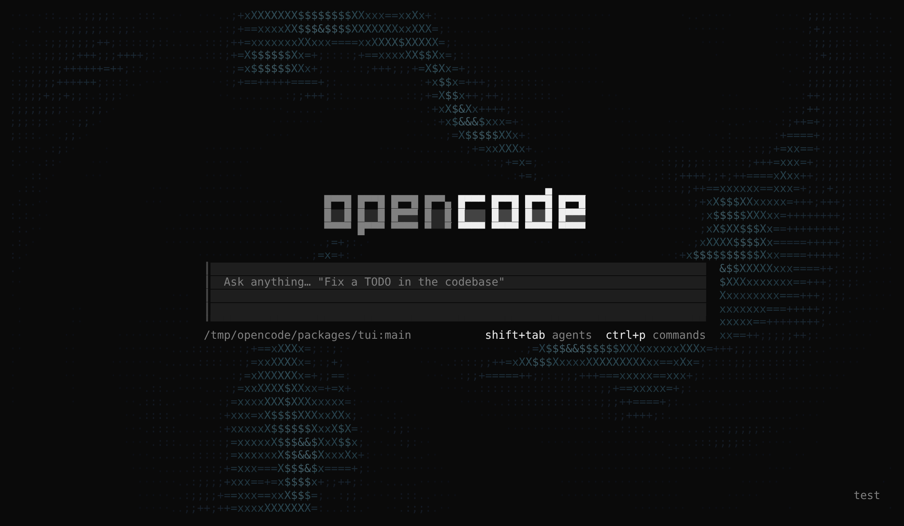
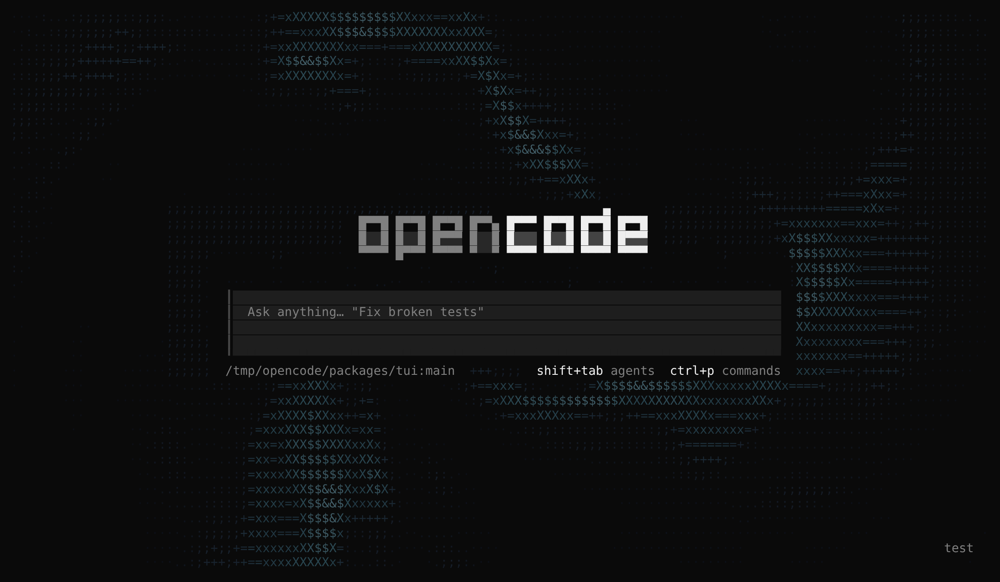

# Vortex Background for OpenCode

An interactive ASCII vortex that swirls behind the OpenCode terminal UI. It reacts to your mouse, your keystrokes and
the model's streaming output, and it never covers or shifts any part of the interface.

> [!NOTE]
> This is a fork of [anomalyco/opencode](https://github.com/anomalyco/opencode). It is not built by the OpenCode team
> and is not affiliated with them. Everything else about OpenCode works as upstream documents it; see the
> [OpenCode docs](https://opencode.ai/v2/docs).



## What you get

- **A slowly swirling vortex** of ASCII glyphs (` ·.:;+=xX$&#@`) around a calm, empty centre, coloured from deep
  midnight blue at the edges to soft cyan at the brightest crests. Colours are blended toward your theme's background
  so they stay dim.
- **Your text always stays readable.** The vortex only fills empty background. It never draws over text, borders,
  code diffs, panels, selections or links, and it keeps a two-cell gap around everything it passes.
- **Mouse wake.** Move the pointer and the flow bends and swirls around it, then settles back.
- **Typing ripples.** Each keystroke sends a soft ring outward from the cursor in the prompt.
- **Streaming boost.** While the model is replying, the vortex spins faster and its waves tighten. It eases back when
  the reply ends.
- **Watermark mode.** Carves the word OPENCODE out of the middle of the flow as empty space.
- **Light on resources.** It animates at 24 frames per second only while something is happening. After 30 seconds with
  no input and no streaming, it slows to a stop and uses no CPU until you move or type again.



## Before you start

You need:

| Requirement                | Details                                                                                                           |
| -------------------------- | ----------------------------------------------------------------------------------------------------------------- |
| **Git**                    | To download the code.                                                                                             |
| **Bun 1.4.4**              | The JavaScript runtime OpenCode is built with. The repo pins this exact version.                                  |
| **A modern terminal**      | One with 24-bit colour and mouse support, such as Ghostty, WezTerm, Kitty, iTerm2, Alacritty or Windows Terminal. |
| **An AI provider account** | For example an OpenAI, Anthropic or OpenRouter API key, which you connect inside OpenCode in step 5.              |

This fork was built and tested on Linux. macOS should work the same way. On Windows, using WSL is the safest way to
build from source.

## Step-by-step setup

### Step 1: Install Bun

macOS and Linux:

```bash
curl -fsSL https://bun.sh/install | bash -s "bun-v1.4.4"
```

Open a new terminal window, then check the version. It should print `1.4.4`:

```bash
bun --version
```

### Step 2: Download the code

```bash
git clone https://github.com/swissmarley/Opencode.git
```

```bash
cd Opencode
```

### Step 3: Install the dependencies

```bash
bun install
```

This takes a minute or two the first time.

> [!TIP]
> If the install reports `failed to download ghostty-web`, your network is blocking GitHub downloads. That package is
> only used by the desktop and web apps, so the terminal UI and the vortex still work.

### Step 4: Start OpenCode

Run it from source and point it at the project you want to work on:

```bash
bun run dev ~/path/to/your/project
```

The vortex is on by default, so you should see it swirling behind the home screen straight away.

> [!TIP]
> If you also use the official OpenCode, add `--standalone` so this build runs its own private server instead of
> sharing (and possibly replacing) the background service your installed OpenCode uses:
>
> ```bash
> bun run dev --standalone ~/path/to/your/project
> ```

### Step 5: Connect an AI provider

Inside OpenCode, type this into the prompt and press Enter:

```text
/connect
```

Pick your provider and follow the prompts to paste your API key or sign in. Then choose a model:

```text
/models
```

You can now ask OpenCode anything. Watch the vortex speed up while the reply streams in.

### Step 6: Play with the background

- **Move your mouse** across the screen to stir the flow.
- **Type in the prompt** to send ripples out from the cursor.
- **Press `Ctrl+X`, then `V`** to switch between the three modes: `vortex` → `watermark` → `off`. A short message
  confirms the new mode, and OpenCode remembers your choice.

### Step 7 (optional): Build a standalone `opencode` binary

If you'd rather run a single program than `bun run dev`, build one for your machine:

```bash
bun run --cwd packages/cli build --single
```

If that fails while building the web UI (for example because `ghostty-web` couldn't be downloaded in step 3), skip the
web UI:

```bash
bun run --cwd packages/cli build --single --skip-web-ui
```

The binary is written to `packages/cli/dist/cli-<os>-<arch>/bin/opencode`, for example
`packages/cli/dist/cli-darwin-arm64/bin/opencode` on an Apple Silicon Mac. Copy it somewhere on your `PATH`:

```bash
mkdir -p ~/.local/bin && cp packages/cli/dist/cli-*/bin/opencode ~/.local/bin/opencode
```

Then start it from any project folder:

```bash
opencode
```

> [!WARNING]
> If the official OpenCode is also installed, whichever `opencode` comes first on your `PATH` wins. Rename the copy
> (for example to `opencode-vortex`) if you want to keep both.

## Settings

OpenCode keeps terminal settings in one file:

```text
~/.config/opencode/cli.json
```

(or `$XDG_CONFIG_HOME/opencode/cli.json` if you set `XDG_CONFIG_HOME`). Create the file if it doesn't exist. Changes
apply while OpenCode is running.

```json
{
  "background": "vortex",
  "animations": true,
  "mouse": true
}
```

| Setting      | Values                             | What it does                                                                                                          |
| ------------ | ---------------------------------- | --------------------------------------------------------------------------------------------------------------------- |
| `background` | `"vortex"`, `"watermark"`, `"off"` | Picks the background. Defaults to `"vortex"`.                                                                         |
| `animations` | `true`, `false`                    | With `false`, the background defaults to `"off"`. If you also set `background` yourself, it shows as a still picture. |
| `mouse`      | `true`, `false`                    | Mouse capture. The mouse wake needs this on (it is on by default).                                                    |

> [!NOTE]
> Your editor may underline `background` as unknown, because the published OpenCode settings schema doesn't include
> it. OpenCode itself reads it correctly.

To try a mode without editing the file, set it for one run:

```bash
OPENCODE_CLI_CONFIG_CONTENT='{"background":"watermark"}' bun run dev ~/path/to/your/project
```

### Changing the shortcut

The toggle is `Ctrl+X`, then `V` by default. To use another key, add it to `cli.json`:

```json
{
  "keybinds": {
    "app.toggle.background": "<leader>z"
  }
}
```

`<leader>` is `Ctrl+X` unless you changed it. `Ctrl+B` is possible, but OpenCode already uses it to move the cursor
left in the prompt and to send blocking tools to the background, so binding it here takes those over.

## Troubleshooting

**I don't see the vortex at all.**
Press `Ctrl+X`, then `V` to cycle the modes; it may be set to `off`. If you have `"animations": false`, the background
defaults to off; add `"background": "vortex"` to turn it back on.

**The colours look flat, grey or blocky.**
Your terminal is probably limited to 256 colours. Enable true colour in its settings. Inside tmux, add this line to
`~/.tmux.conf` and restart tmux:

```text
set -as terminal-features ",*:RGB"
```

**Moving the mouse does nothing.**
Make sure `"mouse": true` is set (it is the default). Inside tmux, also add `set -g mouse on` to `~/.tmux.conf`.

**The glyphs look misaligned or the screen jitters.**
Some terminals draw the `·` dot as a double-width character, especially with East Asian language settings. Turn off
"treat ambiguous-width characters as double width" in your terminal's settings.

**It uses more CPU than I'd like.**
The vortex animates only while you're active or a reply is streaming, and stops after 30 seconds of inactivity. On a
typical 200×60 terminal it uses about 7% of one CPU core while animating. To turn it off completely, press `Ctrl+X`,
then `V` until it says `off`, or set `"background": "off"`.

**`git push` fails with a Bun version error.**
The repo's push hook requires Bun 1.4.4. Repeat step 1 to install that version.

## For developers

The feature lives in the terminal UI package:

| File                                              | Purpose                                                                                                |
| ------------------------------------------------- | ------------------------------------------------------------------------------------------------------ |
| `packages/tui/src/ui/vortex.ts`                   | The shader: the noise field, glyph ramp, colour palette and compositor.                                |
| `packages/tui/src/component/vortex-background.ts` | Hooks the shader into the renderer: the 24 FPS ticker, mouse, keystrokes, streaming and idle throttle. |
| `packages/tui/src/app.tsx`                        | Mounts the background and registers the `app.toggle.background` command.                               |
| `packages/tui/src/config/index.tsx`               | Adds the `background` setting.                                                                         |
| `packages/tui/src/config/keybind.ts`              | Adds the default `<leader>v` shortcut.                                                                 |

The vortex is drawn as a renderer post-process pass, after the interface has painted each frame. It only writes to
cells that are still a plain space on the theme's base background, so it can never change layout or overwrite
content.

Run the checks from the package directory:

```bash
cd packages/tui
```

```bash
bun test test/vortex.test.tsx test/vortex-app.test.tsx
```

```bash
bun run typecheck
```

For the full lint and type check, run `bun run check` from the repository root.

## License

MIT. This fork's notice is in [`LICENSE`](LICENSE), and the upstream OpenCode notice is preserved in
[`LICENSE.opencode`](LICENSE.opencode).
